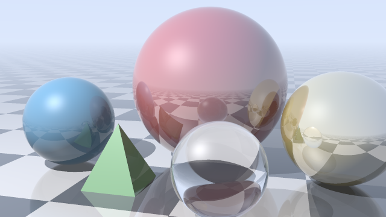

# trace-rays

A ray tracer in one Python file with no dependencies. It renders spheres and a
pyramid of triangles on a checkered floor with shadows, reflections, a specular
highlight and a ball of glass that bends the floor upside down, and writes the
PNG itself.

    python raytracer.py -w 640 -s 3 -o render.png        # every core but one
    python raytracer.py -w 640 -s 3 -o render.png -p 1   # one core, for comparison
    python raytracer.py -w 400 -H 400 -o square.png      # any shape; 16:9 without -H

Each row is drawn independently, so rows are shared across processes. On this
machine's four cores the full image above takes 87 seconds instead of 246,
and the file is byte for byte the same either way. The glass ball more than
doubled both: every ray that meets glass splits into two.

Every pixel is one question asked backwards: instead of following light from
the lamp, send a ray out through that pixel and ask what it hits. A shadow is
the same question again from the surface toward the light, and a reflection is
the same question again from the surface along the bounce. Three uses of one
routine make the whole picture.

## What it does

- Ray and sphere intersection solved as a quadratic, ray and plane as one
  division, ray and triangle by Moller-Trumbore, with the nearest positive hit
  winning.
- Lambert shading, a Blinn-Phong highlight, shadow rays, and reflections up to
  four bounces deep, stronger at a glancing angle as on any real surface.
- Glass: Snell's law for the bend, total internal reflection when the angle
  is too steep to get out, and Schlick's approximation for how much reflects.
- A checkered floor that is just the parity of the floored coordinates.
- Grid supersampling, which is what removes the jagged edges.
- sRGB gamma, without which the whole image looks muddy.
- A PNG written by hand: header, scanline filter bytes, IDAT and the CRC on
  every chunk.

## Checking a picture

Pictures are hard to test, so the checks avoid looking at the picture. They
pin the geometry (a ray at a unit sphere two units away must hit at t=1, a
grazing ray must touch at one point, a ray pointing away must miss), compare
one floor point to itself with and without the sphere that shadows it, and
hand the PNG to Pillow, which is not my code, to read back. Glass is checked
against numbers worked out by hand: a ray half a radius off centre must come
out of the ball turned 21.06 degrees toward the axis, and leave at the same
30 degrees it went in. Triangles are checked against a second method, plane
first and then the three edges, on 3,000 random rays.

Each check was proved able to fail by breaking one thing at a time: removing
the occlusion test, dropping the PNG scanline filter byte, swapping the
quadratic's roots, and flipping the surface normal. For glass, seven more:
the wrong ratio or the wrong side of the surface on the way out, Snell's sign
flipped, Schlick read from the wrong side, glass casting a full shadow or none,
and shares of light that no longer add up to one. Each produced a different
failure.

    python test_raytracer.py

## Notes

[DOCS.md](DOCS.md) is what the maths taught me, including the two lines that
every ray tracer needs and nobody mentions.
